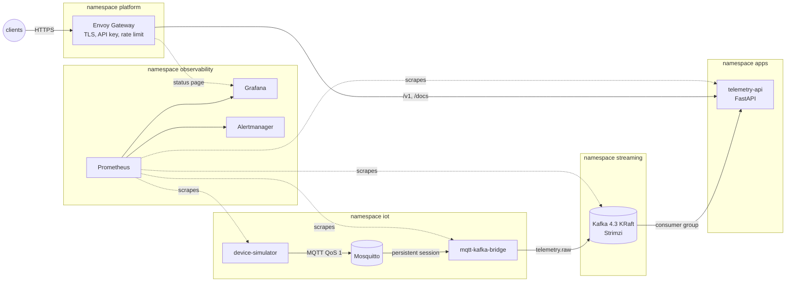

# integration-platform-lab

A small **integration platform on Kubernetes**, run locally in containers at zero cost and managed
entirely through **GitOps**. Simulated IoT devices publish telemetry over **MQTT**, a bridge moves it
into **Kafka**, and a **telemetry API** serves it behind **Envoy Gateway** (TLS, API keys, rate
limits). Prometheus and Grafana watch the flow, and an **incident lab** breaks it on purpose, with
runbooks that walk through diagnosis and recovery.

It is a hands-on lab on operating such a platform: reliability, security, clear operations and
troubleshooting matter more than features.

<!-- LIVE-LINKS -->

## Two-minute tour

| What to look at | Where |
|---|---|
| Everything in the cluster comes from Git through Argo CD (app-of-apps, one AppProject per domain) | [`gitops/root`](gitops/root), [ADR-003](docs/adr/ADR-003-gitops.md) |
| Default-deny NetworkPolicies, every allow rule with a "why" | [`gitops/platform/guardrails`](gitops/platform/guardrails) |
| API management at the gateway: 401 without a key, 429 over the limit | [`gitops/apps`](gitops/apps), [ADR-002](docs/adr/ADR-002-gateway-api.md) |
| At-least-once MQTT → Kafka, with back-pressure instead of data loss | [`gitops/iot`](gitops/iot), [`services/mqtt-kafka-bridge`](services/mqtt-kafka-bridge) |
| Symptom-first alerts, each with a promtool test and a runbook | [`gitops/observability`](gitops/observability), [`docs/runbooks`](docs/runbooks) |
| An incident injected, detected, diagnosed and recovered through Git | [`incidents`](incidents), [runbook](docs/runbooks/incident-dns.md), [postmortems](docs/postmortems) |
| How it was built with an AI coding agent, including what was corrected | [`docs/how-this-was-built.md`](docs/how-this-was-built.md) |

## Architecture



| Layer | Choice |
|---|---|
| Cluster | k3d (k3s v1.35 in Docker), one node, Traefik disabled — [ADR-001](docs/adr/ADR-001-k3d.md) |
| Delivery | OpenTofu installs Argo CD v3.6 and the root app; Helm for third-party charts, Kustomize for ours |
| Networking | Gateway API + Envoy Gateway v1.9, cert-manager internal CA, default-deny NetworkPolicies |
| Integration | Strimzi 1.3 / Kafka 4.3 (KRaft, one node) — [ADR-004](docs/adr/ADR-004-strimzi-kraft.md); Eclipse Mosquitto 2.1 |
| Services | Python 3.12: `device-simulator`, `mqtt-kafka-bridge`, `telemetry-api`; images on GHCR |
| Observability | kube-prometheus-stack (Prometheus, Alertmanager, Grafana, kube-state-metrics), lean |
| Secrets | Sealed Secrets — [ADR-005](docs/adr/ADR-005-sealed-secrets.md) |
| Exposure | Cloudflare Tunnel connector on the host; only the status page and the API docs are public |

### Local → AWS

Every local component has a production counterpart ([ADR-006](docs/adr/ADR-006-aws-mapping.md)):

| Local | AWS / EKS |
|---|---|
| k3d | EKS, managed node groups |
| Envoy Gateway (Gateway API) | same manifests on EKS behind an NLB, or AWS LB Controller Gateway API |
| cert-manager internal CA | ACM / ACM Private CA |
| ServiceAccount per workload | IRSA / EKS Pod Identity |
| Sealed Secrets | Secrets Manager + External Secrets Operator, KMS |
| NetworkPolicies | VPC design, security groups for pods, PrivateLink |
| Strimzi Kafka | Amazon MSK |
| Mosquitto | AWS IoT Core |
| kube-prometheus-stack | Amazon Managed Prometheus + Managed Grafana |

## Quickstart

Prerequisites (macOS): Docker Desktop (≥ 8 GB memory), `k3d`, `kubectl`, `opentofu` (or
`terraform`), `kubeseal`, `jq`. `scripts/install-tools-macos.sh` installs pinned, SHA-256 verified
binaries. Linters and tests run inside Docker.

```bash
make prereqs && make env     # tools check; .env (gitignored) with generated local secrets
make test && make lint       # unit tests; yamllint, shellcheck, ruff, kubeconform, promtool, tofu, secret scan

make cluster                 # k3d cluster "ipl", HTTPS on 127.0.0.1:8443
make bootstrap               # OpenTofu: Argo CD + root Application (Argo CD syncs from GitHub)
make status                  # Argo CD apps, pods not ready, firing alerts
make smoke                   # acceptance checks of every phase

make grafana-ui              # http://localhost:3000, dashboard "Integration Platform overview"
make argocd-ui               # http://localhost:8080 (local only, never published)
```

Try the API (the keys come from the decrypted Secret in the cluster):

```bash
KEY=$(kubectl -n apps get secret telemetry-api-keys -o jsonpath='{.data.demo}' | base64 -d)
kubectl -n platform get secret internal-root-ca -o jsonpath='{.data.ca\.crt}' | base64 -d > /tmp/ipl-ca.crt
curl --cacert /tmp/ipl-ca.crt -H "x-api-key: $KEY" https://api.ipl.localhost:8443/v1/readings/latest
```

Services only, without Kubernetes: `make dev-up && make dev-smoke` (Docker Compose, API on
http://127.0.0.1:8088/docs). `make help` lists every target.

## Incident lab

```bash
make break-dns       # the bridge gets a Kafka hostname that does not resolve (live drift)
                     # ~5 min later: TelemetryPipelineStalled fires; follow docs/runbooks/incident-dns.md
make restore-dns     # Argo CD puts the Git state back; prints the timeline and the message count
```

What it shows: a symptom alert (data stopped flowing) rather than a cause alert; readiness that
tells which dependency broke; GitOps turning "what changed?" into a diff and recovery into a sync;
and the delivery guarantee: messages queued in Mosquitto during the outage reach Kafka afterwards.

## Security baseline

- Default-deny NetworkPolicies in every domain namespace; Kafka accepts only the bridge and the API.
- Our workloads: one ServiceAccount each, no API token mounted, no Kubernetes permissions (checked
  with `kubectl auth can-i` in `make smoke`); non-root, read-only root filesystem, all capabilities
  dropped, no `restricted` Pod Security warnings.
- Pod Security `baseline` enforced in every domain namespace, `restricted` audited.
- Secrets in Git only as SealedSecrets; `make check-secrets` fails on plain Secrets.
- Public surface: only routed hostnames through the tunnel; Argo CD and admin UIs local only.

## Reliability choices

- **At-least-once into Kafka.** The bridge acknowledges an MQTT message only after Kafka accepted
  it (idempotent producer, `acks=all`); while Kafka is unreachable, Mosquitto queues the messages
  for the bridge's persistent session.
- **Readiness reflects dependencies.** The bridge is unready without MQTT or Kafka; the API stays
  ready and serves the last known readings.
- **Operational hygiene.** Structured JSON logs, graceful shutdown, `/healthz`, `/readyz`,
  `/metrics` on every service.

## Built with an AI coding agent

Each task in [PLAN.md](PLAN.md) was implemented by a coding agent following [CLAUDE.md](CLAUDE.md),
validated in a sandbox (unit tests, lint, server-side dry-run against the real CRDs), delivered as a
pull request, verified on the cluster and reviewed by a human. The log, including the problems
found on the real cluster and how they were fixed, is in
[docs/how-this-was-built.md](docs/how-this-was-built.md).

## Next steps

Deliberately left out to keep the lab small (PLAN §6):

- Client mTLS for the API; TLS and authentication for MQTT and Kafka clients.
- More incident scenarios: `cert` (expiring gateway certificate), `netpol` (missing allow rule), `oom`.
- `infra/envs/aws`: validate-only Terraform for VPC, EKS, Pod Identity, VPC endpoints, KMS, Route 53.
- Integration with the companion file-transfer lab: processed-file events into a Kafka topic.
- kube-linter and Trivy config scans in CI; a FinOps view with OpenCost.

## Repository layout

`cluster/` k3d config · `infra/bootstrap/` OpenTofu (Argo CD + root app) · `gitops/` everything Argo
CD deploys · `services/` Python sources, Dockerfiles, compose dev stack · `incidents/` fault
injection · `tests/` smoke and promtool tests · `tools/` linter image · `docs/` ADRs, runbooks,
postmortems, build log.

## License

[MIT](LICENSE)
